# MARG — Production Architecture

> Machine-learning Assisted Railway Guidance  
> Complete system design for the Delhi–Kanpur AI co-pilot

---

## Table of Contents

1. [System Overview](#1-system-overview)
2. [Folder Structure](#2-folder-structure)
3. [Frontend Architecture](#3-frontend-architecture)
4. [Backend Architecture](#4-backend-architecture)
5. [Database Schema](#5-database-schema)
6. [Redis Architecture](#6-redis-architecture)
7. [API Design](#7-api-design)
8. [WebSocket Architecture](#8-websocket-architecture)
9. [ML Service Architecture](#9-ml-service-architecture)
10. [Simulation Engine Architecture](#10-simulation-engine-architecture)
11. [Deployment Architecture](#11-deployment-architecture)

---

## 1. System Overview

### C4 Context Diagram

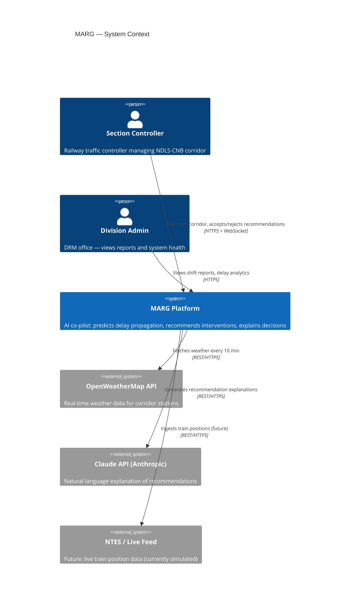

### C4 Container Diagram

```mermaid
C4Container
    title MARG — Container View

    Person(controller, "Section Controller")

    Container(web, "Control Tower UI", "React + TypeScript + Leaflet", "Real-time corridor map, recommendation panel, disruption injection")
    Container(api, "API Gateway", "FastAPI", "REST endpoints, WebSocket hub, auth middleware")
    Container(sim, "Simulation Engine", "Python Service", "Digital twin of NDLS-CNB corridor, event-driven DES")
    Container(ml, "ML Prediction Service", "PyTorch + FastAPI", "LSTM+XGBoost ensemble, delay/cascade predictions")
    Container(opt, "Optimization Engine", "Python + OR-Tools", "Conflict resolution, precedence decisions, rerouting")
    Container(exp, "Explainer Service", "Python + Claude API", "NL justification for recommendations")
    ContainerDb(pg, "PostgreSQL", "PostgreSQL 15", "Schedules, events, shift logs, analytics")
    ContainerDb(redis, "Redis", "Redis 7", "Live sim state, WebSocket pub/sub, prediction cache")

    Rel(controller, web, "Uses", "HTTPS/WSS")
    Rel(web, api, "API calls + WebSocket", "HTTPS/WSS")
    Rel(api, sim, "Tick requests, disruption inject", "Internal HTTP")
    Rel(api, ml, "Prediction requests", "Internal HTTP")
    Rel(api, opt, "Optimization requests", "Internal HTTP")
    Rel(api, exp, "Explanation requests", "Internal HTTP")
    Rel(api, redis, "Pub/sub, state cache", "Redis protocol")
    Rel(api, pg, "Persist events, logs", "SQL/TCP")
    Rel(sim, redis, "Publish sim snapshots", "Redis pub/sub")
    Rel(ml, redis, "Cache predictions", "Redis GET/SET")
    Rel(opt, redis, "Cache recommendations", "Redis GET/SET")
    Rel(exp, claude, "Generate explanations", "HTTPS")
```

---

## 2. Folder Structure

```
marg/
├── apps/
│   ├── web/                          # React frontend
│   │   ├── public/
│   │   │   └── corridor-geojson/     # Station/track GeoJSON files
│   │   ├── src/
│   │   │   ├── components/
│   │   │   │   ├── map/
│   │   │   │   │   ├── CorridorMap.tsx
│   │   │   │   │   ├── TrainMarker.tsx
│   │   │   │   │   ├── SectionOverlay.tsx
│   │   │   │   │   ├── WeatherLayer.tsx
│   │   │   │   │   └── FogOverlay.tsx
│   │   │   │   ├── control/
│   │   │   │   │   ├── RecommendationCard.tsx
│   │   │   │   │   ├── RecommendationPanel.tsx
│   │   │   │   │   ├── DisruptionPanel.tsx
│   │   │   │   │   └── AcceptRejectButtons.tsx
│   │   │   │   ├── dashboard/
│   │   │   │   │   ├── ImpactCounter.tsx
│   │   │   │   │   ├── CascadeTree.tsx
│   │   │   │   │   ├── DelayBadge.tsx
│   │   │   │   │   ├── MetricsSidebar.tsx
│   │   │   │   │   └── ShiftSummary.tsx
│   │   │   │   ├── train/
│   │   │   │   │   ├── TrainDetailPanel.tsx
│   │   │   │   │   ├── TrainTimeline.tsx
│   │   │   │   │   └── CrewStatusBadge.tsx
│   │   │   │   └── shared/
│   │   │   │       ├── StatusPill.tsx
│   │   │   │       ├── CounterDisplay.tsx
│   │   │   │       ├── PredictionBar.tsx
│   │   │   │       └── LoadingOverlay.tsx
│   │   │   ├── hooks/
│   │   │   │   ├── useSimulationSocket.ts
│   │   │   │   ├── useTrainPositions.ts
│   │   │   │   ├── useCongestionOverlay.ts
│   │   │   │   ├── useRecommendations.ts
│   │   │   │   └── useImpactMetrics.ts
│   │   │   ├── store/
│   │   │   │   ├── index.ts              # Zustand root store
│   │   │   │   ├── simulationSlice.ts
│   │   │   │   ├── trainsSlice.ts
│   │   │   │   ├── recommendationsSlice.ts
│   │   │   │   └── metricsSlice.ts
│   │   │   ├── services/
│   │   │   │   ├── api.ts                # Axios client, base URL, interceptors
│   │   │   │   ├── websocket.ts          # WebSocket connection manager
│   │   │   │   ├── simulationApi.ts
│   │   │   │   ├── recommendationsApi.ts
│   │   │   │   └── disruptionsApi.ts
│   │   │   ├── types/
│   │   │   │   ├── train.ts
│   │   │   │   ├── station.ts
│   │   │   │   ├── simulation.ts
│   │   │   │   ├── recommendation.ts
│   │   │   │   └── websocket.ts
│   │   │   ├── utils/
│   │   │   │   ├── interpolation.ts      # Train position interpolation
│   │   │   │   ├── congestionColors.ts   # Score → color mapping
│   │   │   │   ├── timeFormat.ts
│   │   │   │   └── delayClassifier.ts
│   │   │   ├── pages/
│   │   │   │   ├── ControlTower.tsx      # Main controller view
│   │   │   │   ├── Analytics.tsx         # Shift reports
│   │   │   │   └── Settings.tsx
│   │   │   ├── App.tsx
│   │   │   └── main.tsx
│   │   ├── package.json
│   │   ├── tsconfig.json
│   │   └── vite.config.ts
│   │
│   └── api/                          # FastAPI backend monolith
│       ├── app/
│       │   ├── main.py               # FastAPI app, lifespan, CORS
│       │   ├── config.py             # Settings via pydantic-settings
│       │   ├── dependencies.py       # DB session, Redis, auth
│       │   ├── routers/
│       │   │   ├── simulation.py     # /simulation/*
│       │   │   ├── trains.py         # /trains/*
│       │   │   ├── disruptions.py    # /disruptions/*
│       │   │   ├── recommendations.py
│       │   │   └── analytics.py
│       │   ├── websocket/
│       │   │   ├── manager.py        # Connection registry
│       │   │   ├── broadcaster.py    # Redis → WS fan-out
│       │   │   └── handlers.py       # Inbound WS message routing
│       │   ├── schemas/
│       │   │   ├── train.py
│       │   │   ├── simulation.py
│       │   │   ├── recommendation.py
│       │   │   └── analytics.py
│       │   └── middleware/
│       │       ├── auth.py
│       │       └── request_id.py
│       ├── pyproject.toml
│       └── Dockerfile
│
├── services/
│   ├── simulation/                   # Simulation engine (internal service)
│   │   ├── engine/
│   │   │   ├── core.py               # SimulationEngine class
│   │   │   ├── entities.py           # Train, Station, Section dataclasses
│   │   │   ├── event_queue.py        # Priority queue, event dispatch
│   │   │   ├── event_handlers.py     # Handler per EventType
│   │   │   └── snapshot.py           # SimSnapshot builder
│   │   ├── corridor/
│   │   │   ├── ndls_cnb.py           # Hard-coded corridor definition
│   │   │   ├── schedule_loader.py    # WTT schedule → Train objects
│   │   │   └── graph.py              # NetworkX corridor graph
│   │   ├── physics/
│   │   │   ├── delay_generator.py
│   │   │   ├── weather_engine.py
│   │   │   └── crew_tracker.py
│   │   ├── api.py                    # FastAPI app exposing sim to gateway
│   │   └── Dockerfile
│   │
│   ├── ml/                           # ML prediction service
│   │   ├── models/
│   │   │   ├── lstm.py               # DelayLSTM definition
│   │   │   ├── xgboost_model.py      # XGBoost wrapper
│   │   │   └── ensemble.py           # MARGEnsemble
│   │   ├── pipeline/
│   │   │   ├── feature_extractor.py
│   │   │   ├── sequence_builder.py
│   │   │   └── scaler.py
│   │   ├── serving/
│   │   │   ├── predictor.py          # Inference entry point
│   │   │   └── cache.py              # Redis prediction cache
│   │   ├── training/                 # Offline — not deployed
│   │   │   ├── dataset_generator.py
│   │   │   ├── train_lstm.py
│   │   │   ├── train_xgb.py
│   │   │   └── evaluate.py
│   │   ├── artifacts/                # Tracked by DVC
│   │   │   ├── lstm_best.pt
│   │   │   ├── xgb_best.json
│   │   │   └── scaler.pkl
│   │   ├── api.py
│   │   └── Dockerfile
│   │
│   ├── optimization/                 # OR-Tools optimization service
│   │   ├── engine/
│   │   │   ├── conflict_detector.py
│   │   │   ├── cp_sat_resolver.py
│   │   │   ├── greedy_resolver.py
│   │   │   ├── priority_scorer.py
│   │   │   └── graph_algorithms.py
│   │   ├── recommendations/
│   │   │   ├── builder.py            # Decision → Recommendation
│   │   │   └── deduplicator.py
│   │   ├── api.py
│   │   └── Dockerfile
│   │
│   └── explainer/                    # Claude API wrapper service
│       ├── explainer.py              # Prompt builder + Claude call
│       ├── cache.py                  # Cache identical contexts
│       ├── api.py
│       └── Dockerfile
│
├── data/
│   ├── corridor/
│   │   ├── stations.json             # 28 stations, real coordinates
│   │   ├── sections.json             # Track sections with attributes
│   │   └── wtt_schedule.json         # Working Timetable for NDLS-CNB
│   ├── training/                     # Generated by dataset_generator
│   │   ├── train.parquet
│   │   ├── val.parquet
│   │   └── test.parquet
│   └── geojson/
│       ├── track_ndls_cnb.geojson
│       └── stations.geojson
│
├── infra/
│   ├── docker-compose.yml            # Local development
│   ├── docker-compose.prod.yml       # Production overrides
│   └── nginx/
│       └── nginx.conf                # Reverse proxy config
│
├── scripts/
│   ├── generate_dataset.py
│   ├── train_models.py
│   └── seed_db.py
│
├── notebooks/
│   ├── 01_eda_delay_patterns.ipynb
│   ├── 02_feature_engineering.ipynb
│   ├── 03_lstm_training.ipynb
│   └── 04_evaluation.ipynb
│
├── .env.example
├── .gitignore
├── README.md
└── ARCHITECTURE.md                   # This document
```

---

## 3. Frontend Architecture

### Component Hierarchy

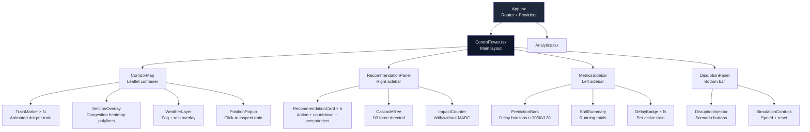

### State Management (Zustand)

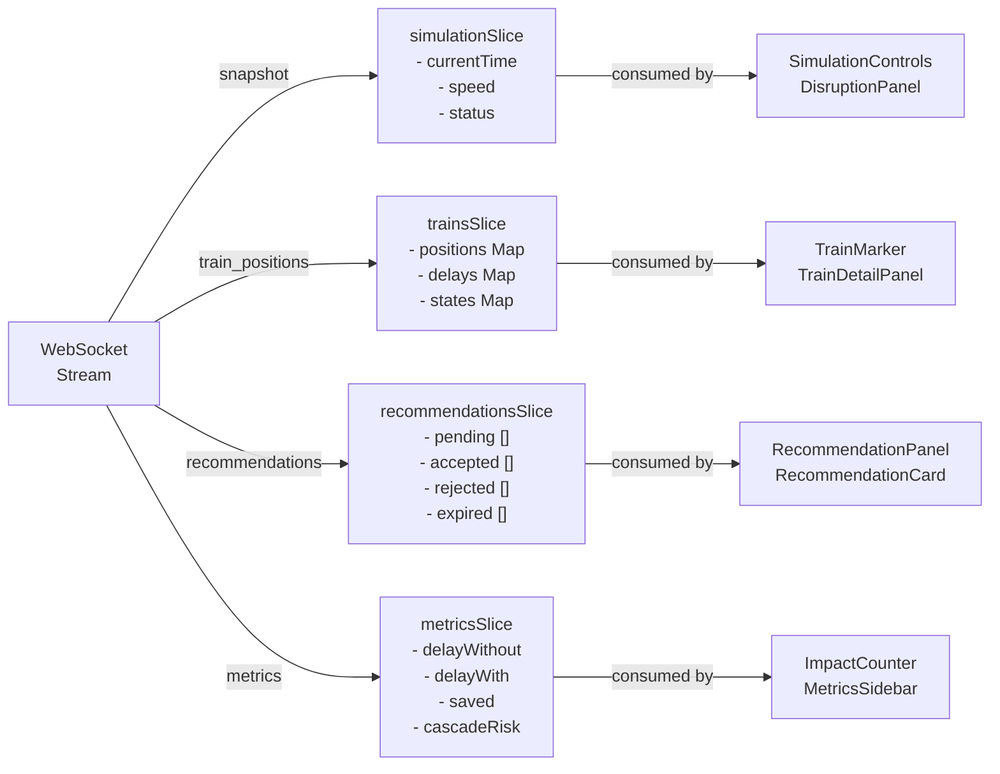

### Data Flow — Render Loop

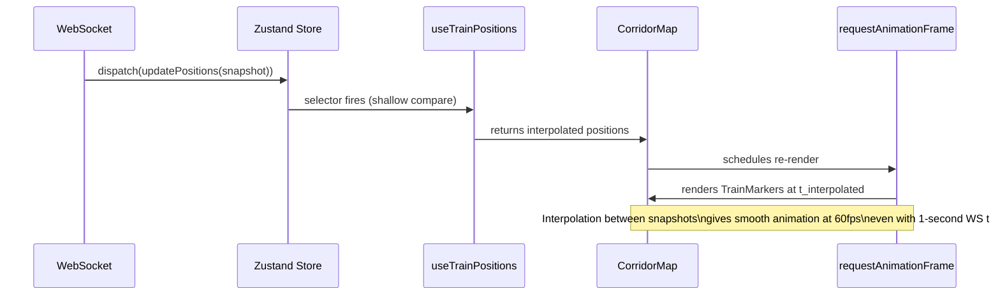

---

## 4. Backend Architecture

### Service Interaction

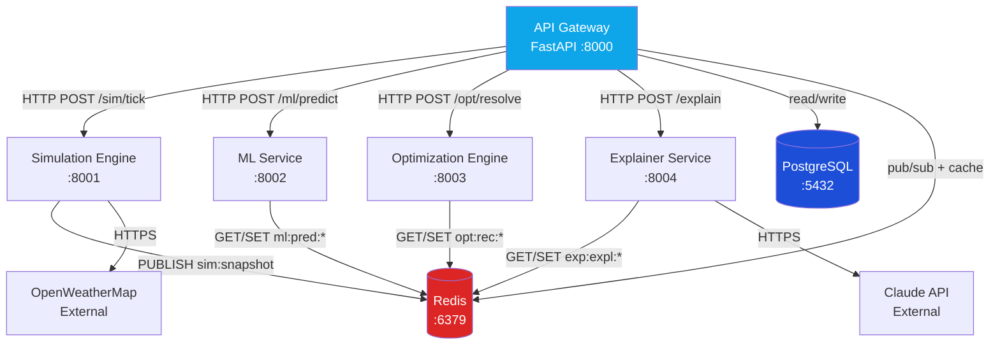

### Request Lifecycle — Optimization Cycle

```mermaid
sequenceDiagram
    participant Timer as Tick Timer (1s)
    participant GW as API Gateway
    participant SIM as Simulation
    participant Redis as Redis
    participant ML as ML Service
    participant OPT as Optimizer
    participant EXP as Explainer
    participant WS as WebSocket Broadcaster

    Timer->>GW: trigger cycle
    GW->>SIM: POST /advance {minutes: 1}
    SIM-->>GW: SimSnapshot (train positions, section states)
    GW->>Redis: PUBLISH sim:snapshot {snapshot}

    par Parallel inference
        GW->>ML: POST /predict {snapshot}
        ML-->>GW: PredictionResult[]
    and
        GW->>Redis: GET opt:rec:latest
        Redis-->>GW: cached recs (if fresh < 5s)
    end

    GW->>OPT: POST /optimize {snapshot, predictions}
    OPT-->>GW: ResolutionPlan {decisions[], alerts[]}

    loop Top 3 decisions needing explanation
        GW->>EXP: POST /explain {context}
        EXP-->>GW: "Hold 22691 at Aligarh 12 min → saves 41 min. Risk: low."
    end

    GW->>Redis: PUBLISH ws:broadcast {snapshot, predictions, recommendations}
    Redis-->>WS: subscriber receives
    WS->>WS: fan-out to all connected clients
```

---

## 5. Database Schema

### Entity Relationship Diagram

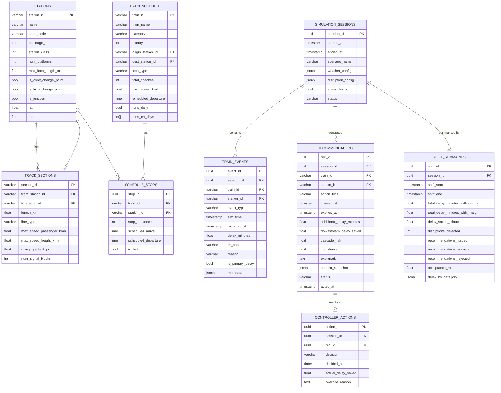

---

## 6. Redis Architecture

### Key Schema and TTL Policy

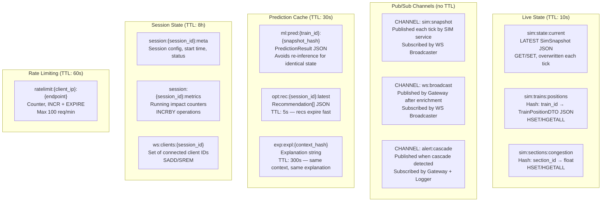

### WebSocket Fan-Out via Redis Pub/Sub

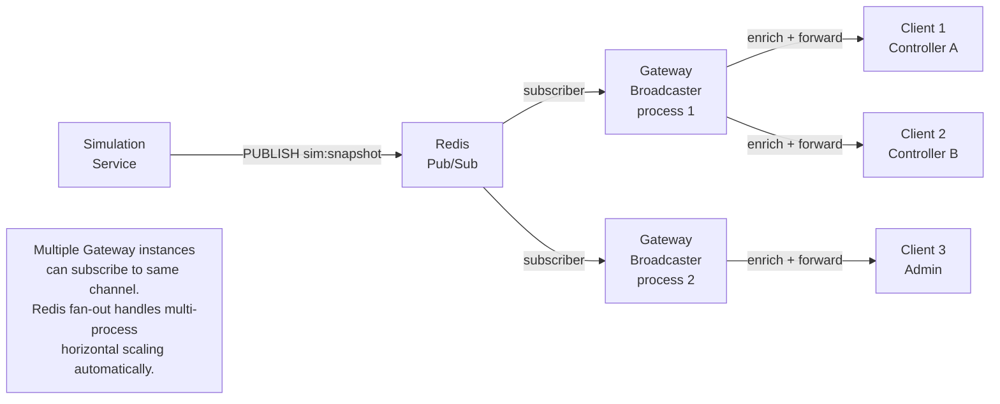

---

## 7. API Design

### REST Endpoints

```
BASE URL: https://api.marg.railway.in/v1

SIMULATION
──────────────────────────────────────────────────────────────
POST   /simulation/start          Start a new simulation session
POST   /simulation/stop           Stop current session
POST   /simulation/reset          Reset to schedule state
PATCH  /simulation/speed          Set playback speed {factor: 1-100}
GET    /simulation/state          Current snapshot (polling fallback)
GET    /simulation/sessions       List past sessions
GET    /simulation/sessions/{id}  Session detail + summary

TRAINS
──────────────────────────────────────────────────────────────
GET    /trains                    All active trains + positions
GET    /trains/{train_id}         Single train detail, crew state
GET    /trains/{train_id}/history Delay history for current session

DISRUPTIONS
──────────────────────────────────────────────────────────────
POST   /disruptions               Inject a disruption
  Body: { type, location, severity, duration_minutes }
DELETE /disruptions/{id}          Cancel a disruption
GET    /disruptions               Active disruptions list

RECOMMENDATIONS
──────────────────────────────────────────────────────────────
GET    /recommendations           Current pending recommendations
POST   /recommendations/{id}/accept   Controller accepts
POST   /recommendations/{id}/reject   Controller rejects with reason
PATCH  /recommendations/{id}/modify   Modify parameters before accept

ANALYTICS
──────────────────────────────────────────────────────────────
GET    /analytics/shift/{session_id}   Shift summary report
GET    /analytics/delay-trends         Historical delay by category
GET    /analytics/cascade-events       Past cascade incidents
GET    /analytics/recommendation-accuracy  Accepted recs vs actual outcome

CORRIDOR (static, cached)
──────────────────────────────────────────────────────────────
GET    /corridor/stations          All stations
GET    /corridor/sections          All track sections
GET    /corridor/schedule          Full WTT schedule
```

### REST Response Envelope

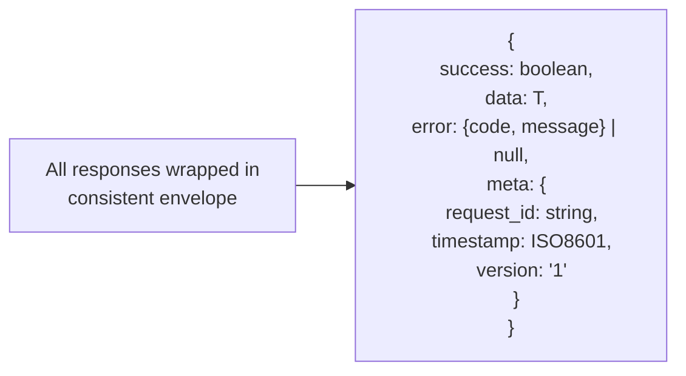

### WebSocket Message Protocol

```
CONNECTION
  wss://api.marg.railway.in/v1/ws?session_id={id}&client_id={uuid}

INBOUND MESSAGES (client → server)
──────────────────────────────────
{ type: "ping" }
{ type: "subscribe_train", train_id: "12301" }
{ type: "unsubscribe_train", train_id: "12301" }
{ type: "accept_recommendation", rec_id: "uuid" }
{ type: "reject_recommendation", rec_id: "uuid", reason: "string" }
{ type: "inject_disruption", disruption: DisruptionDTO }
{ type: "set_speed", factor: 60 }

OUTBOUND MESSAGES (server → client)
──────────────────────────────────
{ type: "pong", server_time: ISO8601 }
{ type: "simulation_tick", payload: SimSnapshotDTO }
{ type: "train_update", payload: TrainPositionDTO[] }
{ type: "congestion_update", payload: SectionCongestionDTO[] }
{ type: "recommendation_issued", payload: RecommendationDTO }
{ type: "recommendation_expired", rec_id: "uuid" }
{ type: "cascade_alert", payload: CascadeAlertDTO }
{ type: "metrics_update", payload: MetricsDTO }
{ type: "disruption_ack", disruption_id: "uuid", status: "active" }
{ type: "error", code: string, message: string }
```

---

## 8. WebSocket Architecture

### Connection Management

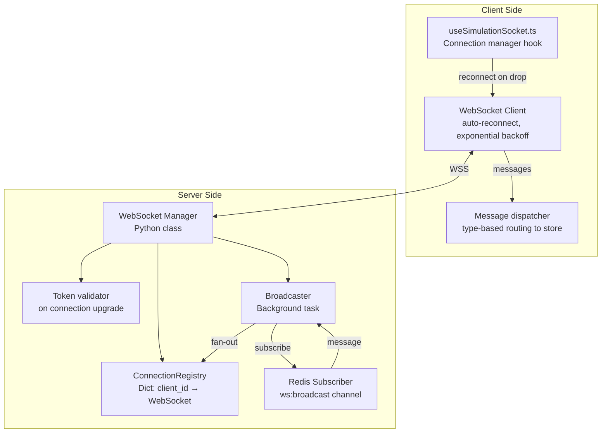

### Message Flow Timing

```mermaid
gantt
    title WebSocket Cycle — 1 second tick
    dateFormat ss.SSS
    axisFormat %S.%L

    section Simulation
    Advance sim 1 minute     :00.000, 50ms
    Build SimSnapshot        :50ms, 30ms

    section ML
    Extract features         :00.000, 20ms
    LSTM inference           :20ms, 80ms
    XGBoost inference        :20ms, 30ms
    Ensemble combine         :100ms, 10ms

    section Optimization
    Detect conflicts         :80ms, 40ms
    CP-SAT resolve           :120ms, 150ms
    Build recommendations    :270ms, 30ms

    section Explainer
    Claude API call          :300ms, 150ms

    section Broadcast
    Compose WS message       :450ms, 20ms
    Redis PUBLISH            :470ms, 10ms
    Client receives          :490ms, 10ms
```

---

## 9. ML Service Architecture

### Training vs Serving Separation

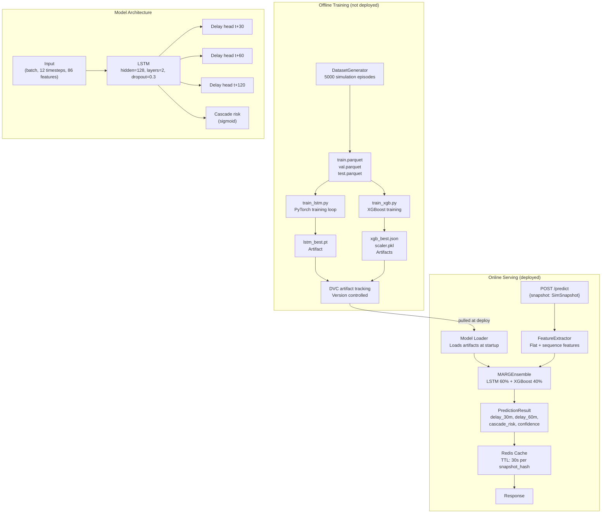

### Prediction Caching Strategy

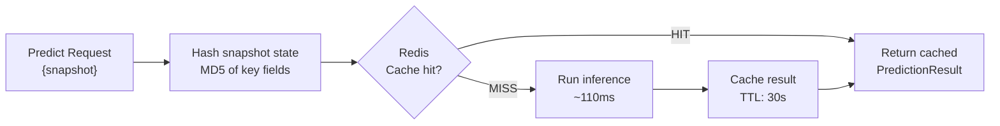

---

## 10. Simulation Engine Architecture

### Event-Driven Architecture

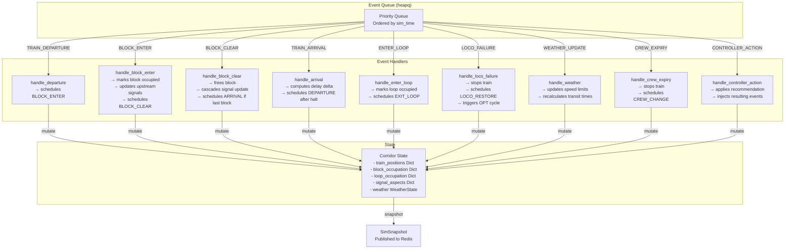

### Simulation Speed Control

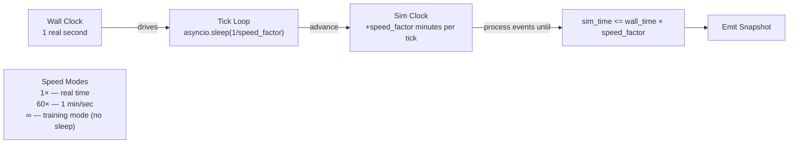

---

## 11. Deployment Architecture

### Infrastructure Overview

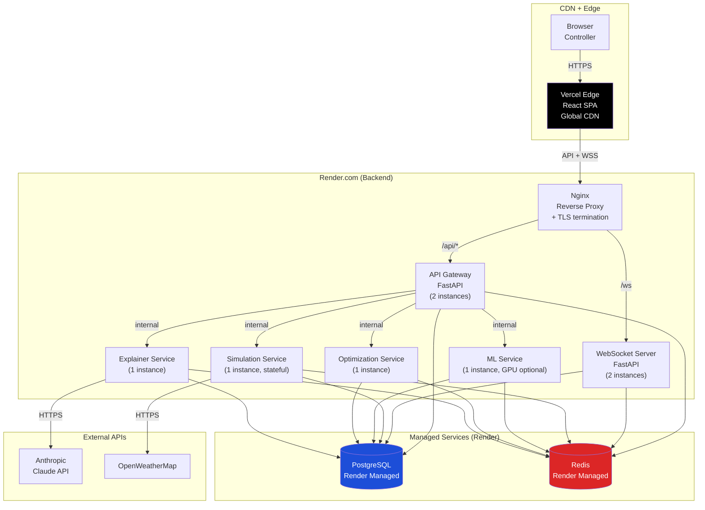

### CI/CD Pipeline

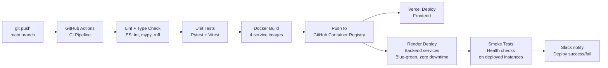

### Environment Configuration

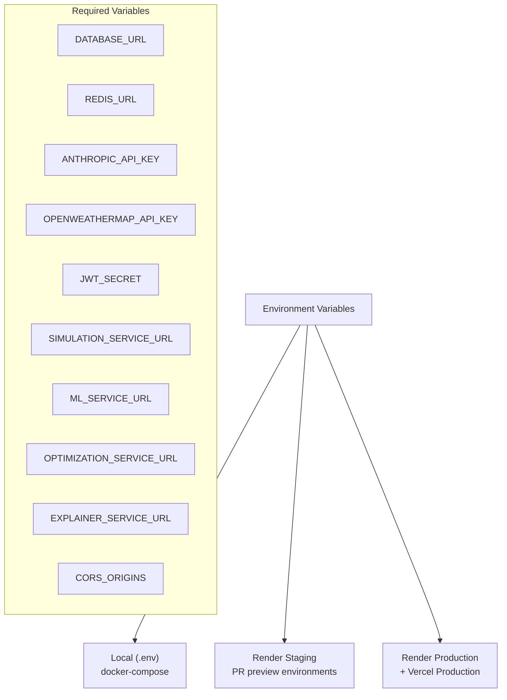

### Health Check and Observability

```mermaid
graph LR
    subgraph "Health Endpoints"
        H1["GET /health\nLiveness — is the process up?"]
        H2["GET /health/ready\nReadiness — DB + Redis connected?"]
        H3["GET /health/deep\nModel loaded? Sim initialized?"]
    end

    subgraph "Metrics (future)"
        M1["Prometheus scrape\n/metrics endpoint"]
        M1 --> M2["Grafana dashboard\nLatency, throughput,\nprediction accuracy"]
    end

    subgraph "Logging"
        L1["Structured JSON logs\nrequest_id, session_id,\nduration_ms, status"]
        L1 --> L2["Render log aggregation\nor external (Logtail)"]
    end
```

---

## Architectural Decisions — Rationale

| Decision | Chosen | Rejected | Reason |
|---|---|---|---|
| State management | Zustand | Redux | Simpler for real-time map state; no boilerplate |
| Backend framework | FastAPI | Django | Async-native; automatic OpenAPI docs; faster |
| Service communication | Internal HTTP | gRPC | Simpler for hackathon; gRPC for production v2 |
| Simulation isolation | Separate service | In-process | Stateful engine needs isolation from stateless API |
| ML serving | FastAPI wrapper | Triton | Triton overkill for 1 model; FastAPI sufficient |
| WS fan-out | Redis pub/sub | In-memory | Supports multiple API gateway instances |
| Explainer caching | Context hash | No cache | Claude API latency 150ms+ — cache identical contexts |
| DB for events | PostgreSQL | MongoDB | Structured schema, relational queries for analytics |
| Deployment | Vercel + Render | AWS | Free tier sufficient; zero-config TLS; fast setup |

---

*Architecture version 1.0 — MARG, FAR AWAY 2026*
